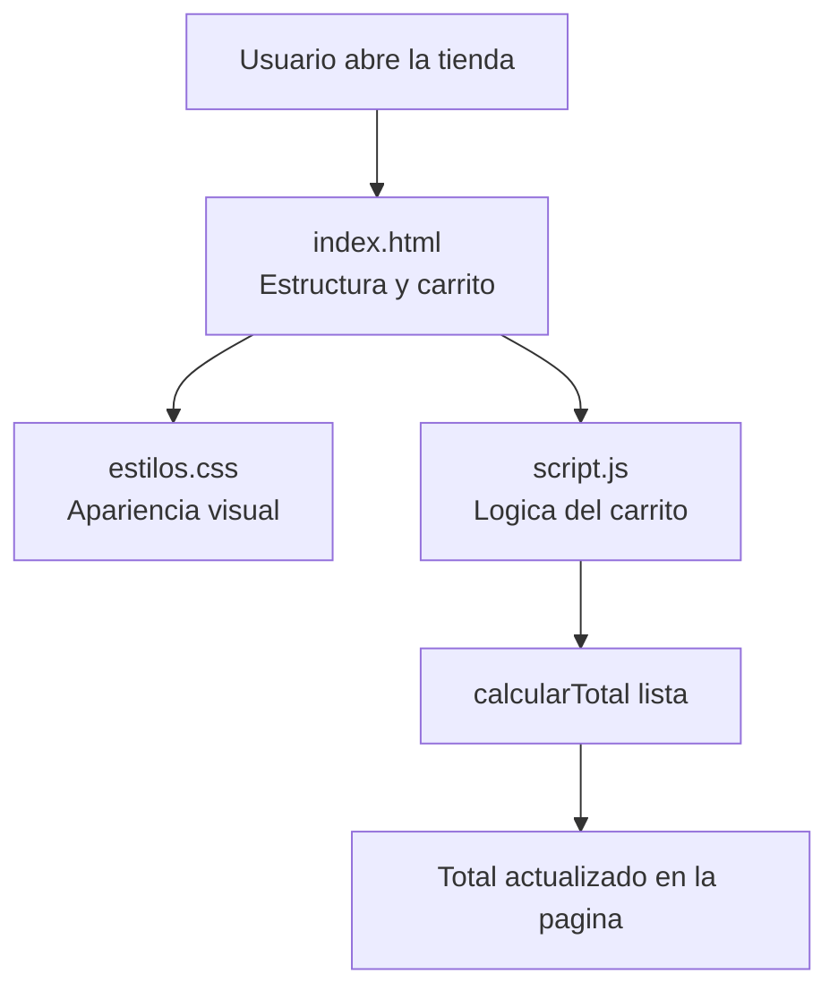

# Tienda TECSUP


Tienda TECSUP es una pequeña aplicación web de práctica que muestra productos y calcula el total de un carrito de compras según su precio y cantidad. Está dirigida a estudiantes que están aprendiendo desarrollo frontend y colaboración con Git y GitHub.

## Tabla de contenidos

- [Descripcion](#descripcion)
- [Caracteristicas](#caracteristicas)
- [Tecnologias](#tecnologias)
- [Instalacion](#instalacion)
- [Uso](#uso)
- [Estructura del proyecto](#estructura-del-proyecto)
- [Hoja de ruta](#hoja-de-ruta)
- [Arquitectura](#arquitectura)
- [Contribuir](#contribuir)
- [Licencia](#licencia)
- [Autor](#autor)

## Descripcion

El proyecto simula una tienda sencilla en el navegador sin requerir un servidor ni una base de datos. El código separa la estructura de la página, su apariencia visual y la lógica que calcula el monto del carrito.

## Caracteristicas

- Presenta productos de ejemplo, como un polo y una taza TECSUP.
- Calcula el total de acuerdo con el precio y la cantidad de cada producto.
- Separa la estructura HTML, los estilos CSS y la lógica JavaScript.
- Sirve como ejercicio académico para practicar correcciones mediante ramas, commits, Issues y Pull Requests.

## Tecnologias

| Tecnologia | Uso en el proyecto | Archivo principal |
|:---|:---|:---:|
| HTML5 | Estructura de la página y elementos del carrito. | `index.html` |
| CSS3 | Colores, tipografía y presentación visual. | `estilos.css` |
| JavaScript | Cálculo del total y actualización del contenido. | `script.js` |

## Instalacion

### Requisitos previos

- Git instalado, si deseas clonar el repositorio.
- Un navegador actualizado.
- Opcional: Visual Studio Code para revisar y editar el código.

### Descargar el proyecto

Clona tu fork de GitHub. Reemplaza `TU-USUARIO` por tu usuario de GitHub y utiliza la URL de tu propio repositorio:

```bash
git clone https://github.com/TU-USUARIO/tienda-tecsup.git
cd tienda-tecsup
```

No es necesario instalar paquetes ni ejecutar un proceso de compilación: el proyecto utiliza HTML, CSS y JavaScript del lado del navegador.

## Uso

Abre el archivo `index.html` con un navegador. En Windows PowerShell también puedes ejecutarlo desde la carpeta del proyecto:

```powershell
Start-Process .\index.html
```

La página debe cargar los estilos de `estilos.css` y ejecutar `script.js`. La función de cálculo debe multiplicar el precio de cada producto por su cantidad. Por ejemplo, la lógica central puede expresarse así:

```javascript
function calcularTotal(lista) {
  let total = 0;

  for (const producto of lista) {
    total += producto.precio * producto.cantidad;
  }

  return total;
}
```

Con los datos de ejemplo descritos en la práctica —dos polos de S/ 25.00 y una taza de S/ 18.00—, el total esperado es **S/ 68.00**.

## Estructura del proyecto

| Archivo | Responsabilidad | Obligatorio |
|:---|:---|:---:|
| `index.html` | Contiene la página y los elementos visibles del carrito. | Sí |
| `estilos.css` | Define la presentación, los colores y la tipografía. | Sí |
| `script.js` | Contiene la lógica para calcular el total. | Sí |
| `README.md` | Explica el proyecto, su instalación y su uso. | Documentación |
| `CONTRIBUTING.md` | Describe cómo reportar problemas y proponer cambios. | Documentación |

## Hoja de ruta

- [x] Mostrar productos de ejemplo en la página.
- [x] Separar la estructura, los estilos y la lógica en archivos distintos.
- [x] Calcular el total multiplicando el precio por la cantidad.
- [x] Documentar el proyecto y las reglas básicas para colaborar.
- [ ] Validar que los precios y las cantidades sean valores válidos.
- [ ] Añadir pruebas automatizadas para la función de cálculo.
- [ ] Evaluar guardar el contenido del carrito entre visitas.

## Arquitectura

La aplicación funciona en el navegador. `index.html` carga la presentación de `estilos.css` y la lógica de `script.js`; el JavaScript calcula el total y muestra el resultado en la página. No se documenta un backend ni una base de datos para esta práctica.



## Contribuir

Las contribuciones y sugerencias son bienvenidas. Antes de modificar el código, revisa las reglas de reporte, ramas, commits y Pull Requests en [CONTRIBUTING.md](./CONTRIBUTING.md).

## Licencia

No se ha identificado un archivo `LICENSE` en la información disponible del proyecto. Hasta que el propietario publique una licencia, no se debe asumir que el código puede reutilizarse o distribuirse libremente.

## Autor

Proyecto académico de **Juver Adiel Escobedo Carhuamaca**, desarrollado como práctica de Diseño y Desarrollo de Software.
